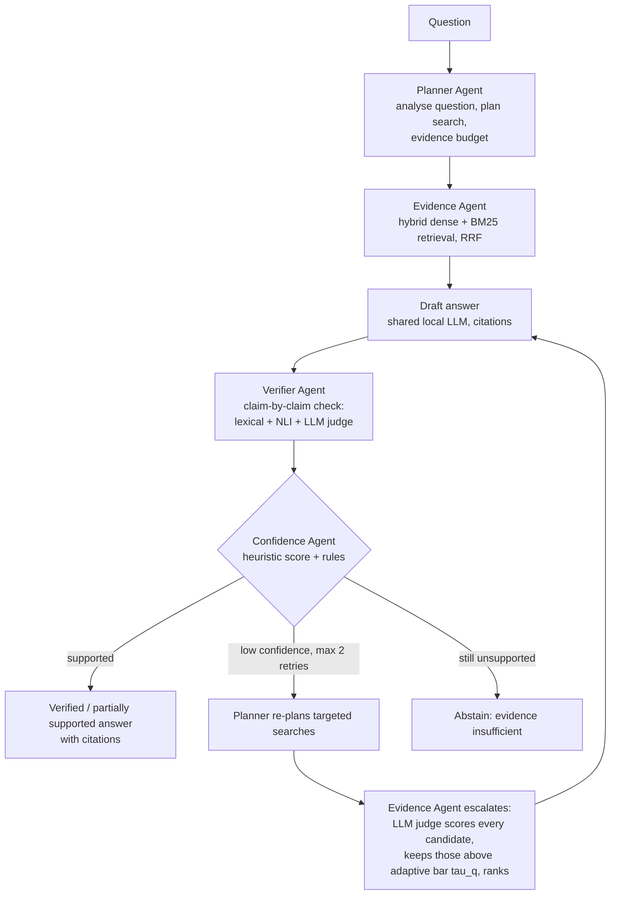

# RAG-Based Adaptive Framework for Multi-Agent Systems

An **adaptive Multi-Agent Retrieval-Augmented Generation (RAG)** system that answers questions from your own documents.
Four cooperating agents — **Planner, Evidence, Verifier, Confidence** — plan the search, gather and filter evidence,
verify every claim of the answer against it, and then **answer, retrieve again, or abstain**. A Standard RAG pipeline
is kept as the baseline for fair comparison.

**New here? Follow [RUN_PROJECT.md](RUN_PROJECT.md)** — a step-by-step Windows guide to install, run, test and
benchmark the project.

Everything runs **locally on a Windows laptop** (tested: 32 GB RAM, RTX 3050 Laptop GPU 4 GB). No paid APIs, no
Docker, no cloud.

> **Measured results (held-out TriviaQA questions never used during development, two runs):** Multi-Agent RAG v2
> answered more answerable questions correctly than Standard RAG in both runs — 73.9 % vs 67.9 % (p = 0.021) and
> 72.7 % vs 69.1 % (p = 0.146, exact McNemar) — mainly through fewer wrong refusals, at 4–4.5× the mean latency.
> The improvement was significant in one of the two runs, so it is promising but not yet conclusive. An optional
> **question routing** (now the default) kept v2's accuracy (73.3 % vs 72.7 %) with 21 % fewer LLM calls and 26 %
> lower mean latency; its gain over Standard RAG was not statistically significant (p = 0.065). One dataset, one 4B model:
> see [docs/results.md](docs/results.md). The system reduces, but does not eliminate, unsupported answers; its
> confidence score is a heuristic, not a calibrated probability.

---

## How it works



| Agent | Responsibility | Code |
|---|---|---|
| **Planner** | needs retrieval?; query type, keywords, focus terms, sub-questions; **routes the question** (simple → lightweight round, ≤ 1 escalation; complex/ambiguous → full workflow, ≤ 2); evidence budget; targeted re-planning on retries | `src/adaptive_rag/agents/planner.py` |
| **Evidence** | hybrid retrieval; on escalation, MAIN-RAG-inspired filtering: dedup → LLM judge score `log P(Yes) − log P(No)` → adaptive bar `τ_q = mean − n·σ` → descending order → budget | `agents/evidence.py` |
| **Verifier** | splits the answer into claims; lexical support (numbers must match), NLI entailment/contradiction; short answers need the answer text **and** a judge confirmation; contradictions must be corroborated | `agents/verifier.py` |
| **Confidence** | `C = 0.25·relevance + 0.25·coverage + 0.35·verification + 0.15·consistency`; answer / retry / partial answer / abstain, with a written reason | `agents/confidence.py` |

All four agents share **one** LLM instance; every step is recorded in a real execution trace shown in the UI.
How the design relates to **MAIN-RAG (Chang et al., ACL 2025)** — what is used exactly, what is adapted, and what is
not claimed — is documented in [docs/main_rag_alignment.md](docs/main_rag_alignment.md).

## Default configuration

Question routing is **on by default** (`ARAG_QUESTION_ROUTING=true`): the Planner sends simple factual questions through
a lightweight round with at most one escalation to the full four-agent workflow, and complex or ambiguous questions
through the full workflow with up to two escalations. Set `ARAG_QUESTION_ROUTING=false` to run the evaluated v2
behaviour. `ARAG_HARDWARE_PROFILE=8gb|16gb|32gb` selects laptop defaults (only `32gb` was benchmarked).

## Results (held-out test, run `20261011-122005-0a2d3c`)

| System (same questions, corpus, model, prompt) | Accuracy | Wrong abstention | Correct abstention | Mean latency | LLM calls |
|---|---|---|---|---|---|
| Standard RAG (baseline) | 67.9 % | 19.4 % | 79.4 % | 3.6 s | 1.0 |
| **Multi-Agent RAG v2 (proposed)** | **73.9 %** | **13.9 %** | 79.4 % | 15.2 s | 9.3 |
| v2 without adaptive retries | 63.0 % | 27.3 % | 82.4 % | 3.9 s | 1.3 |
| v2 without evidence filtering | 72.7 % | 17.6 % | 76.5 % | 9.4 s | 3.0 |
| v1 (original pipeline) | 64.2 % | 29.1 % | 79.4 % | 10.5 s | 3.0 |

Routing was evaluated in a second held-out run (`20261011-171730-9902e7`): Standard 69.1 %, v2 72.7 %, v2 + routing
73.3 %; v2 + routing used 7.5 instead of 9.5 LLM calls and 12.1 s instead of 16.4 s on average. Neither multi-agent
variant's gain over Standard RAG was significant in that run (p = 0.146 and 0.065). Details: [docs/results.md](docs/results.md) Part D.

165 answerable + 34 unanswerable questions (first run). The adaptive retries carry most of the gain (v2 vs no-retry: 18 vs 0,
p < 0.001); the evidence filter's contribution is small and not significant (7 vs 5, p = 0.77). Development history
(original v1 baseline, two v2 iterations on questions 1–100) is in [docs/results.md](docs/results.md).

## Documentation

| Document | Content |
|---|---|
| [docs/how_it_works.md](docs/how_it_works.md) | **Start here** — plain-language walk-through of one question through the four agents |
| [docs/architecture.md](docs/architecture.md) | Diagrams, agents, confidence formula, configuration switches, failure handling |
| [docs/main_rag_alignment.md](docs/main_rag_alignment.md) | Paper-to-code comparison with MAIN-RAG |
| [docs/results.md](docs/results.md) | Original baseline, development iterations, held-out test, ablations, significance |
| [docs/evaluation_protocol.md](docs/evaluation_protocol.md) | Datasets, dev/test split, systems, metric definitions, statistics |
| [docs/tech_stack.md](docs/tech_stack.md) | Technologies and models, sizes, licences, hardware requirements |
| [docs/setup_guide.md](docs/setup_guide.md) | Detailed Windows setup, model downloads, troubleshooting |
| [docs/user_guide.md](docs/user_guide.md) | How to use each page of the dashboard |
| [docs/api_reference.md](docs/api_reference.md) | REST endpoints and response fields |
| [docs/testing.md](docs/testing.md) | Test suite (mocked vs real models), defects found and fixed |
| [docs/limitations_and_future_work.md](docs/limitations_and_future_work.md) | Known limitations and next steps |
| [docs/faq.md](docs/faq.md) | Questions and answers about the design and results, plus a demo script |

## Quick start (Windows PowerShell)

Prerequisites: **Python 3.12**, **Node.js 20+**, **Git**, **Ollama** (https://ollama.com/download).

```powershell
git clone https://github.com/rabbunimerugumala/RAG-Based-Adaptive-Framework-for-Multi-Agent-Systems.git
cd RAG-Based-Adaptive-Framework-for-Multi-Agent-Systems

# backend
py -3.12 -m venv .venv
.\.venv\Scripts\Activate.ps1
python -m pip install --upgrade pip
pip install torch --index-url https://download.pytorch.org/whl/cpu    # CPU PyTorch for the NLI verifier
pip install -e ".[nli,dev]"
Copy-Item .env.example .env                                           # set ARAG_MODE=real for local models

# local LLM (~2.5 GB)
ollama pull qwen3:4b-instruct-2507-q4_K_M

# frontend
cd frontend; npm install; Copy-Item .env.example .env.local; cd ..
```

Run (two terminals):

```powershell
# Terminal 1 - backend: http://127.0.0.1:8000  (API docs: /docs)
.\.venv\Scripts\Activate.ps1
$env:ARAG_MODE = "real"            # "dev" = no downloads, no LLM (development/testing only)
uvicorn adaptive_rag.api.app:app --port 8000

# Terminal 2 - frontend: http://localhost:3000
cd frontend
npm run dev                        # or: npm run build; npm run start
```

Open http://localhost:3000 → **Document Library** → upload files from `data/sample_documents/` → **Ask Documents**
(Multi-Agent RAG is the default) → **View agent trace**.

### Tests and benchmarks

```powershell
pytest                                                          # 156 fast tests with mocked models (4 real-model tests skipped)
$env:ARAG_RUN_REAL_MODEL_TESTS = "1"; pytest -m real_model      # 4 tests with the real local models
cd frontend; npm run lint; npm run build; cd ..

python evaluation/run_benchmark.py --dataset smoke_test --mode real                       # smoke test (24 synthetic questions)
python evaluation/prepare_triviaqa.py --offset 100 --n 200 --out data/datasets/triviaqa_heldout_101_300 `
    --exclude-dataset data/datasets/triviaqa_unfiltered_sample                            # prepare held-out set
python evaluation/run_benchmark.py --dataset triviaqa_heldout_101_300 --mode real `
    --methods standard,adaptive_v2,adaptive_no_retry,adaptive_no_filter,adaptive_v1 --repeat 20   # reproduces Part C (~3 h)
# note: 'adaptive' now means the current defaults (routing on); 'adaptive_v2' is the v2 evaluated in Parts C and D
python evaluation/analyze_results.py <run_id>                                             # metrics + McNemar tests
```

(The held-out set needs the development set first: `python evaluation/prepare_triviaqa.py --n 100`, and the
`datasets` extra: `pip install -e ".[datasets]"`.)

## Run modes

| Mode | Embeddings | Generator / judge | Verifier | Use |
|---|---|---|---|---|
| `dev` | hashing embedder (lexical) | extractive sentence picker + keyword heuristic, **no LLM** | lexical | development, unit tests — results are labelled and never reported |
| `real` | `BAAI/bge-small-en-v1.5` (CPU) | `qwen3:4b-instruct-2507-q4_K_M` via Ollama (GPU+CPU), log-probability judge | lexical + `nli-deberta-v3-xsmall` (CPU) + judge | demos and experiments |

## Project structure

```
src/adaptive_rag/
  agents/          planner.py · evidence.py · verifier.py · confidence.py
  api/app.py       FastAPI endpoints (health/ready, documents, query, compare, runs, datasets, variants, evaluations)
  evaluation/      datasets.py · metrics.py · runner.py (variants, per-attempt logs)
  generation/      llm.py (Ollama answer/judge/predict, dev generator) · nli.py
  ingestion/       extract.py · chunking.py
  retrieval/       embeddings.py · bm25.py · fusion.py · hybrid.py · store.py (Qdrant local)
  config.py · models.py · pipeline.py · schemas.py · text.py
frontend/          Next.js 16 + React 19 + Tailwind 4 dashboard (Overview, Ask, Trace, Documents, Compare, Evaluation)
data/datasets/smoke_test/   synthetic test set (committed)    data/sample_documents/   demo files
evaluation/        run_benchmark.py · analyze_results.py · prepare_triviaqa.py · validate_dataset.py
tests/             mocked unit/API tests + opt-in real-model tests
docs/              documentation (table above)
```

Generated data (indexes, uploads, saved runs, model cache, TriviaQA samples, result files) is git-ignored and
re-created by the commands above.

## Credits and licence

MIT licence. Related work: C.-Y. Chang et al., *MAIN-RAG: Multi-Agent Filtering Retrieval-Augmented Generation*,
ACL 2025 — this project adapts its judge score and adaptive threshold inside a different, four-agent design and does
not reproduce its results. TriviaQA: Joshi et al., ACL 2017 (downloaded locally by script, not redistributed).
