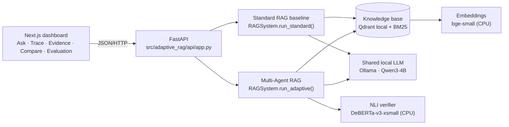
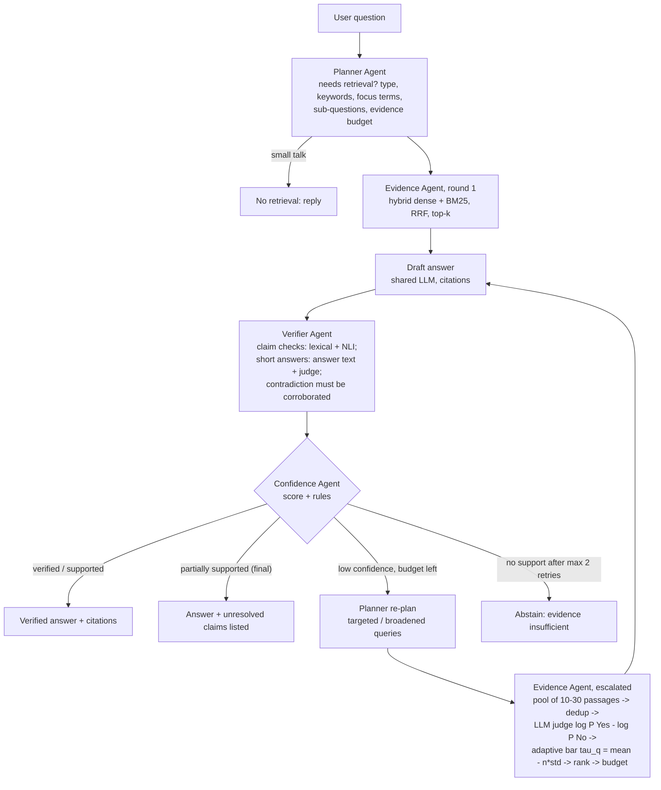

# Architecture (Multi-Agent RAG v2)

## 1. System overview



Everything runs in one Python process plus the Ollama server. One generator instance serves every role (draft
answers, evidence judging, per-passage prediction, query rewriting); no model is loaded twice.

## 2. The adaptive workflow



* **Bounded:** at most `max_retries` = 2 extra rounds (validated in `config.py`), so at most 3 drafts.
* **Adaptive:** easy questions stop after round 1 (one draft LLM call, plus at most 2 judge calls if a short answer
  needs confirmation); judged filtering is spent only on questions the Confidence Agent could not accept.
* **Observable:** every step is recorded as a `TraceStep` (inputs, outputs, decision, timing, status) and shown in
  the Agent Trace page; filtered passages and the filter report (pool, τ_q, mean, σ, kept/removed and reasons) are
  returned with the answer.

## 3. The four agents

| Agent | File | Inputs → outputs | Uses the LLM? |
|---|---|---|---|
| **Planner** | `agents/planner.py` | question → `RetrievalPlan` (needs_retrieval, query type, keywords, focus terms, sub-questions, search queries, top_k, pool_k, strategy, explanation); on retry, a new plan from the Confidence Agent's strategy | only on a retry (≤ 3 reformulated queries) |
| **Evidence** | `agents/evidence.py` | plan → `EvidencePackage` (kept passages renumbered `[1..k]`, filtered passages with reasons, `EvidenceFilterReport`) | yes, as the judge, only when escalated (1 call per passage; 2 in triplet mode); judgments are cached within a run |
| **Verifier** | `agents/verifier.py` | question + draft + evidence → `VerificationResult` (per-claim label, lexical support, NLI entailment/contradiction, best evidence, cited refs, reason; support score; citation consistency) | only to confirm short answers or to cross-check an NLI contradiction (Appendix C triplet judge) |
| **Confidence** | `agents/confidence.py` | plan + evidence + draft + verification → `ConfidenceAssessment` (score, components, missing components, decision, reason, retry strategy); final attempt selection | no |

### Confidence score (heuristic, not a calibrated probability)

```
C = (0.25·relevance + 0.25·coverage + 0.35·verification + 0.15·consistency) / (sum of weights of available components)
```

* **relevance** (v2): share of passages given to the generator that the evidence judge rated relevant
  (log-odds > 0); when no judging happened, keyword overlap of the top-3 passages.
* **coverage**: share of question keywords found in the evidence, averaged with focus-term and sub-question coverage.
* **verification** / **consistency**: from the Verifier (support score; citations pointing at supporting passages).

Decision order: no evidence → retry/abstain · generator says insufficient → retry/abstain · contradicted → retry/abstain
· C ≥ 0.65 and (partially) supported → **answer** · budget left → **retry** (broaden when relevance or coverage
< 0.5, else targeted) · otherwise choose the best attempt (v2: verified answers outrank attempts without an answer)
and answer if C ≥ 0.40 and at least partially supported, else **abstain**.

## 4. Standard RAG baseline (unchanged)

`run_standard()`: one hybrid retrieval (top-5) → one draft with the same prompt and LLM → citation validation.
Its verification is computed **after** the answer and is labelled post-hoc analysis; it never changes the answer.
Round-1 evidence of Multi-Agent RAG uses the same retrieval function, LLM, prompt and top-k; the only difference is
that the Planner adds a keyword-only query variant (2 search queries instead of 1).

## 5. Configuration switches (all in `config.py`, env prefix `ARAG_`)

| Setting | Default | Original v1 | Meaning |
|---|---|---|---|
| `DOC_FILTER` | `judge` | `off` | MAIN-RAG-style judged evidence filtering |
| `DOC_FILTER_STAGE` | `on_retry` | – | `always` = filter every round (paper-like); `on_retry` = escalate only |
| `DOC_JUDGE_MODE` | `pair` | – | `triplet` = paper's Predictor + Doc-Q-A judge |
| `DOC_POOL_K` | 10 | – | passages judged per escalated round |
| `DOC_FILTER_N_SIGMA` | 0 | – | τ_q = mean − n·σ |
| `VERIFIER_MODE` | `grounded` | `v1` | contradiction only from related, well-formed premises; judge-confirmed short answers |
| `CONTRADICTION_CROSS_CHECK` | true | – | an NLI contradiction must not be confirmed by the judge |
| `CONFIDENCE_MODE` | `v2` | `v1` | judge-based relevance; verified-first attempt selection |
| `MAX_RETRIES` | 2 | 2 | additional retrieval rounds (hard cap 2) |

`config.LEGACY_V1` reproduces the original pipeline exactly; the benchmark exposes it as the `adaptive_v1` variant.

## 6. Modules

| Module | Responsibility |
|---|---|
| `config.py` | the single settings system (`ARAG_*`, `.env`), validation, `LEGACY_V1` |
| `schemas.py` | Pydantic models: `Evidence` (incl. judge score, retrieval rank, filter reason), `RetrievalPlan`, `EvidenceFilterReport`, `VerificationResult`, `ConfidenceAssessment`, `TraceStep`, `QueryResponse` (incl. `support_level`, `unresolved_claims`, `filtered_evidence`) |
| `ingestion/` | PDF/DOCX/TXT/MD extraction, safe filenames, page-aware chunking |
| `retrieval/` | fastembed / hash embeddings, own BM25, RRF, hybrid search, Qdrant local knowledge base |
| `generation/llm.py` | `OllamaLLM` (`answer`, `judge`, `predict`, `rewrite_queries`), dev `ExtractiveGenerator`, prompts |
| `generation/nli.py` | NLI cross-encoder |
| `agents/` | the four agents |
| `pipeline.py` | Standard and Multi-Agent orchestration, trace recording, failure handling |
| `evaluation/` | dataset loading/validation, metrics, runner with variants |
| `api/app.py` | REST endpoints, run store, background evaluation jobs |

## 7. Failure handling

* LLM timeouts, HTTP errors and malformed JSON raise `LLMError`; the step is recorded as `failed` and the system
  falls back (judge failure → plain retrieval order; draft failure → treated as insufficient → retry/abstain).
* A retrieval exception is recorded as a failed Evidence step and handled like "no evidence".
* The filter never removes all evidence (`DOC_MIN_KEEP`, default 1).
* Benchmark errors are counted (`n_errors`) and never dropped.

## 8. Security notes

Local prototype without authentication; CORS limited to the local frontend; sanitised filenames; upload size limit;
dataset/run/evaluation ids validated against path traversal; no document text is sent to external services.
