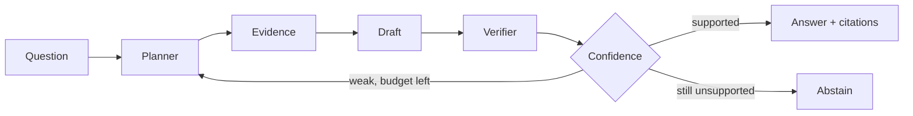

# How It Works — a plain-language guide

This page explains the project step by step, assuming only basic computer-science knowledge.

---

## 1. The problem

Large Language Models (LLMs) write fluent answers, but they **do not know your private documents** and they sometimes
**make things up** ("hallucinate") with full confidence.

## 2. Retrieval-Augmented Generation (RAG)

```
question → search your documents → give the best passages to the LLM → the LLM answers from them, with citations
```

This is **Standard RAG**, our baseline. Its weaknesses: it trusts whatever the search returns, nobody checks the
answer against the passages, and it rarely says "I don't know".

## 3. Our system: Multi-Agent RAG

Four specialised agents share **one** local LLM (loaded once). Each is a separate Python class with a clear job:

| # | Agent | Job in one line | Uses the LLM? |
|---|---|---|---|
| 1 | **Planner** | understand the question and plan the search (and plan a better search if the first one fails) | only when re-planning |
| 2 | **Evidence** | find passages; when more evidence is needed, judge every candidate passage and keep the useful ones | as a *judge*, only when escalated |
| – | answer generator | write a draft answer with citations | yes |
| 3 | **Verifier** | check every claim of the draft against the passages | only to confirm short answers or cross-check a contradiction |
| 4 | **Confidence** | score the answer and decide: answer, retrieve again (max 2), or abstain | no |



The system is **adaptive**: an easy question stops after one round (about the cost of Standard RAG plus checking);
only hard questions trigger the extra agent work.

## 4. Before any question: indexing documents

1. Validate the file (PDF with text, DOCX, TXT, Markdown; max 20 MB; safe filename).
2. Detect duplicates (SHA-256 of the content).
3. Extract text (per page for PDFs). Scanned PDFs are rejected because OCR is not implemented.
4. Chunk into ~900-character pieces with 150 characters of overlap, cutting at sentence ends; chunks keep page numbers.
5. Embed each chunk into a 384-number vector (`bge-small-en-v1.5`) and store it in Qdrant; also index words for BM25.

## 5. Walk-through of one question

> **"How many books can an undergraduate student borrow and for how long?"** (sample file `college_library_rules.txt`)

**Step 1 — Planner (rules).** Not small talk, so retrieval is needed. Type `numeric`; keywords `many, book,
undergraduate, student, borrow, long`; focus term `book`; evidence budget 5 passages; search queries = the question
plus a keyword-only version. Evidence filtering is *held back* for now.

**Step 2 — Evidence, round 1.** For each query: meaning search (Qdrant cosine similarity) and keyword search (BM25),
merged with Reciprocal Rank Fusion (`Σ 1/(60 + rank)`); the top 5 passages are numbered `[1]…[5]`.

**Step 3 — Draft.** The LLM gets the numbered passages and strict rules (use only these, cite `[n]`, say
"insufficient" otherwise) and returns JSON, e.g. *"An undergraduate student can borrow up to 4 books for a period of
14 days. [1]"*.

**Step 4 — Verifier.** The draft is split into claims. For each claim:
* **lexical support**: share of its important words found in a passage; every number must match exactly;
* **NLI**: a small Natural-Language-Inference model reads *passage → claim* and gives entailment/contradiction
  probabilities;
* **short answers** (≤ 4 words, e.g. "Niger"): supported only if the answer text is in a passage **and** the LLM
  judge confirms that passage supports it;
* **contradictions must be corroborated**: if NLI says "contradiction" but the LLM judge confirms the claim, the claim
  is marked *unresolved* instead of contradicted.

**Step 5 — Confidence.**

```
C = 0.25 × relevance + 0.25 × coverage + 0.35 × verification + 0.15 × consistency   (each between 0 and 1)
```

* answer if C ≥ 0.65 and the claims are (partially) supported; this example has one supported claim, so it is
  **answered** after one round;
* otherwise **retrieve again** (up to 2 times) with a new plan;
* after the last retry: answer if C ≥ 0.40 and at least partially supported (unresolved claims are listed),
  otherwise **abstain**.

C is a transparent heuristic, **not** a calibrated probability.

## 6. What happens on a retry (the MAIN-RAG-inspired part)

When the Confidence Agent asks for more evidence:

1. The **Planner** builds new searches: queries from the unsupported claims and missing keywords, broader keyword
   pairs, and up to 3 reformulations suggested by the LLM.
2. The **Evidence Agent** retrieves a larger pool (10–30 passages) and, following MAIN-RAG (ACL 2025):
   * removes near-duplicate passages;
   * asks the LLM, for every passage, *"Does this document provide specific information for answering the question?
     Yes or No"*, and reads the token probabilities: **score = log P(Yes) − log P(No)**;
   * computes the per-question bar **τ = mean of the scores** (optionally mean − n·σ);
   * keeps passages scoring ≥ τ, orders them from best to worst, and keeps at most 5.
3. A new draft is written from these filtered passages and verified again.

Example from the development set: *"What was Walter Matthau's first movie?"* Standard RAG answered "insufficient";
with judged evidence the Multi-Agent system found the right passage and answered *"The Kentuckian (1955)"*, verified.

## 7. Example of abstention

> **"What is the WiFi password of the library?"** The documents never mention WiFi. The draft says "insufficient",
> two retries with broader and filtered evidence find nothing, and the system **abstains** instead of guessing.

## 8. Is it better? (Evaluation)

Both systems answer **the same questions** from **the same documents** with the same LLM. We measure accuracy, wrong
and correct abstention, evidence precision and recall, groundedness, citation correctness, consistency, latency and
LLM calls, and test differences with an exact McNemar test. Design decisions were made on a development set
(TriviaQA questions 1–100); the final comparison uses 199 different questions. The measured numbers are in
[results.md](results.md).

## 9. Key takeaways

* RAG grounds answers in documents; our four agents add **planning**, **evidence filtering**, **claim verification**
  and **confidence-based decisions** (answer / retry / abstain).
* The agents are separate modules with different inputs and outputs, not four names for one LLM call.
* Everything is local and free: Ollama, Qdrant local mode, fastembed, Hugging Face transformers.
* Checking costs time and LLM calls; the adaptive design spends that cost only on questions that need it.
